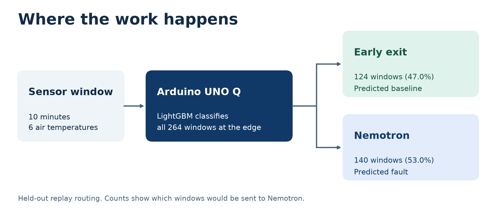

# Fridge Fault Detector

**Help shops catch refrigeration faults early and protect food stock with AI running on the Arduino UNO Q.**

Built for Arduino’s **Make Europe Green through Edge AI using Arduino** challenge at [Junction 2026](https://hackjunction.app/hackathons/junction-2026). Refrigeration is a local problem with direct consequences for shop operators. When cooling degrades, food can spoil and equipment can run inefficiently. Earlier alerts give staff a chance to investigate, protect stock, and address faults sooner.

## How it meets the challenge

| Arduino judging criterion | What the prototype demonstrates |
| --- | --- |
| **Technical Implementation & Edge AI (30%)** | The UNO Q reads six recorded air-temperature channels, computes features over ten-minute windows, and runs the saved seven-class LightGBM model on the board. Local classification and the LED indicator work independently of cloud services. |
| **Environmental & Social Impact (30%)** | The design aims to reduce avoidable food spoilage and help staff identify inefficient cooling sooner. The evaluation measures fault detection and routing. Energy and food savings would require measurements in a live installation. |
| **Creativity & Innovation (20%)** | An independent temperature-based monitor can flag abnormal cooling even when the cause is unclear. Baseline windows exit locally. For a flagged block, the operator can request a sensor-grounded explanation from Nemotron or Gemini. |
| **Working Prototype & Demo (20%)** | The Arduino App Lab project pairs on-board inference and an LED matrix with a dashboard for live replay, incident review, and a simulated security scenario. The demo uses bundled laboratory recordings as sensor input. |

## Best Use of Gemma · Google DeepMind

The Junction judges confirmed that **Gemini 4 Hydrogen** qualifies for this prize. We use it to turn a refrigeration alert into an explanation an operator can check. Select **Gemini 4 Hydrogen** in **Incident review**. The app sends the selected fault block’s timestamped temperatures, the LightGBM prediction, and relevant findings from the refrigeration study. The prompt asks Gemini to compare plausible causes, cite readings, and suggest a practical check.

The first cooling decision runs on the UNO Q. Gemini handles incident review when an operator requests it. See the [Google AI Studio setup](uno_q_app/README.md#explanation-providers). The reported detector metrics measure LightGBM performance.

## Best Use of Nemotron · NVIDIA

**NVIDIA Nemotron 3.5 Super VL helps refrigeration operators decide what to check after an alert.** The UNO Q runs LightGBM on the temperature data and presents its prediction. When an operator selects a flagged block, Nemotron compares plausible causes using the block’s timestamped readings and relevant experimental methods from the refrigeration study. It cites readings and suggests a check an operator can perform.

For example, a chilled-case fan failure and a blocked air return can produce similar temperature changes. The prompt supplies how the researchers staged each fault, asks Nemotron to compare both explanations against the readings, and makes clear that these temperatures alone cannot establish fan speed or airflow.

**See it in the demo.** Choose **Nemotron 3.5** in **Incident review**, then click a scored fault block on the live timeline. The dashboard shows the edge prediction, the readings sent for review, Nemotron’s explanation, and the measured response time. The [desktop replay](demo_gui/README.md) also sends Nemotron a waveform image alongside the matching sensor table so it can cross-check visible patterns against numerical readings.

[Waveform and saved explanation example](images/waveform_to_explanation.png) · [Verda replay test output](results/verda_smoke_test.json) · [Provider setup](uno_q_app/README.md#explanation-providers)

## Run the demo

1. Open [the UNO Q app](uno_q_app/fridge-fault-detector/) in Arduino App Lab and run it on the board. See the [board setup guide](uno_q_app/README.md).
2. In **Live monitoring**, try normal operation, then the freezer-door recording. Watch the edge diagnosis, the measured model time, and the board's LED matrix.
3. Choose an explanation model in **Incident review**, then select a scored fault block on the live timeline to review its sensor evidence. **Security demo** pairs a simulated unauthorized control event with a recorded cooling fault to demonstrate independent monitoring.

The [desktop replay](demo_gui/README.md) is also available for development.

## Submission

Arduino’s challenge requires submission on the [Junction platform](https://hackjunction.app/hackathons/junction-2026) and publication on [Arduino Project Hub](https://projecthub.arduino.cc/) with the **Junction Finland 2026** tag. Use [Arduino App Lab](https://www.arduino.cc/en/software/#app-lab-section) to run the prototype.

## Evaluation

On 264 non-overlapping ten-minute windows from held-out hours of the same recordings, the edge gate achieved **94.7% accuracy**, **93.8% fault recall**, and a **4.2% baseline false-positive rate**. Fault labels describe recording scenarios. The demo flags abnormal cooling behavior. Attributing that behavior to an unauthorized change requires controller evidence.

[Early-exit confusion matrix](images/edge_gate_confusion_matrix.png) · [Detection vs. diagnosis by fault](images/fault_detection_vs_diagnosis.png) · [Waveform and example explanation](images/waveform_to_explanation.png)

## Repository guide

| Path | Contents |
| --- | --- |
| [`uno_q_app/`](uno_q_app/) | Arduino App Lab project, bundled replay data, and model verification tools |
| [`demo_gui/`](demo_gui/) | Desktop replay and offline model training |
| [`notebooks/`](notebooks/) | Data exploration, binary and fault-type classification, and cloud replay |
| [`images/`](images/) | Figures for the notebooks and presentation |
| [`docs/`](docs/) | Source paper and [sensor guide](docs/sensor_data.md) |
| [`data/`](data/) and [`models/`](models/) | Source recordings and exported model artifacts |
| [`results/`](results/) | Saved cloud replay test output |

Run notebook cells from the repository root or the `notebooks/` directory. The opening cell resolves repository-relative inputs.

The recordings are from the [public Figshare dataset](https://doi.org/10.6084/m9.figshare.13232627) and [Sun et al., *Scientific Data* (2021)](https://doi.org/10.1038/s41597-021-00927-6).
